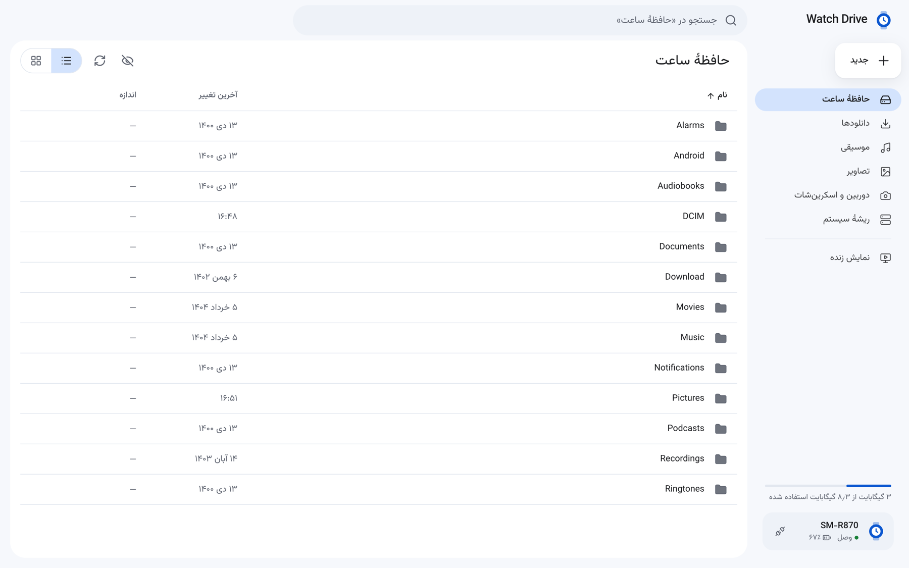
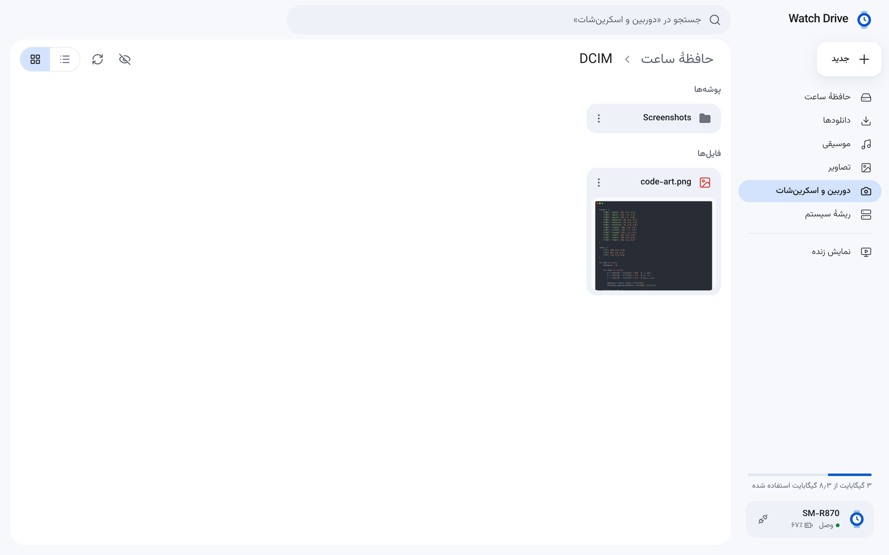
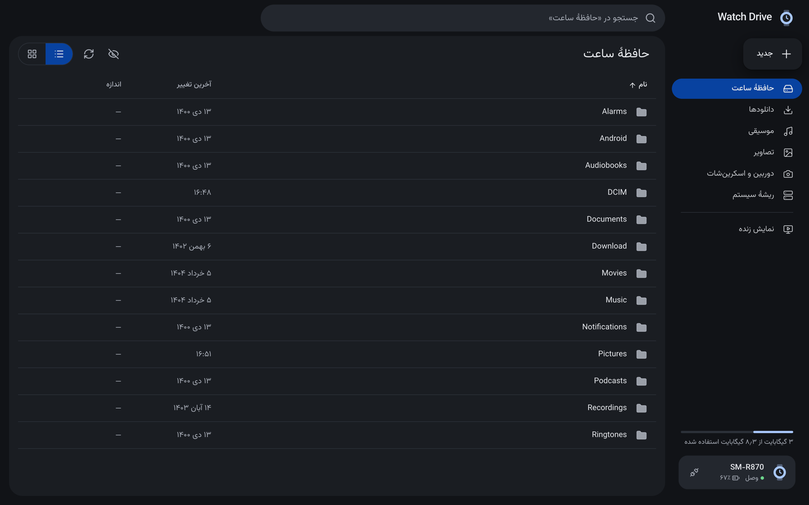
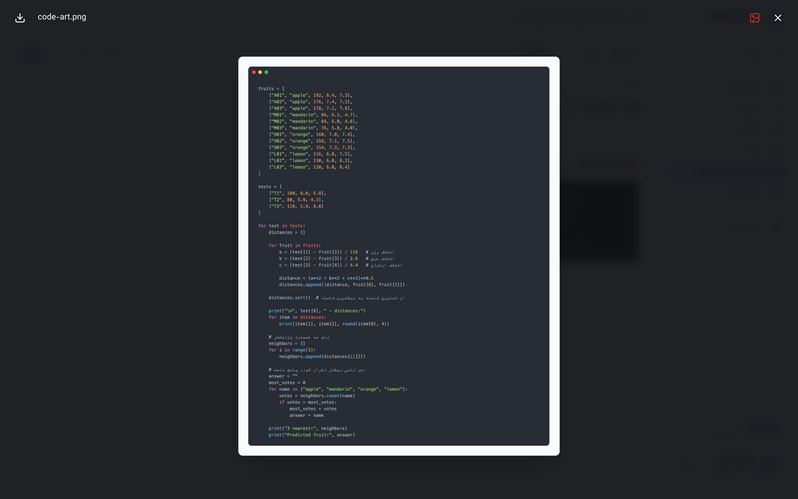
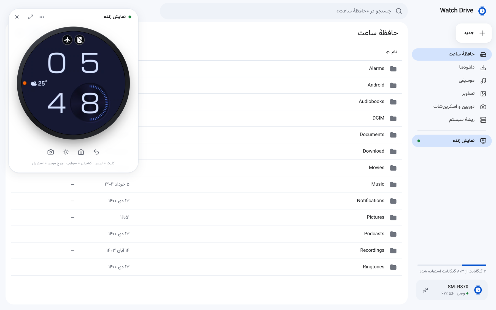
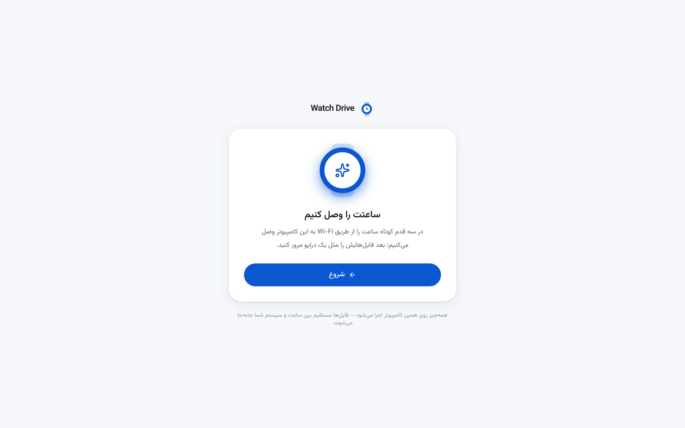
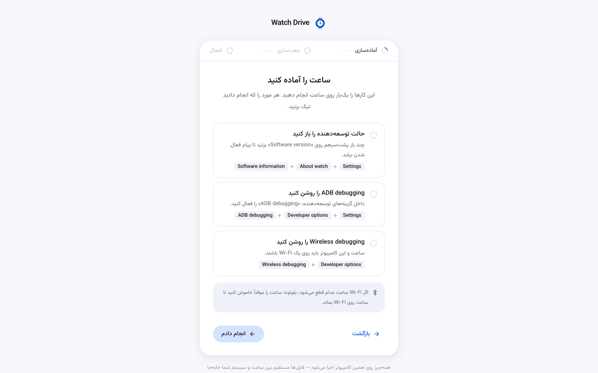
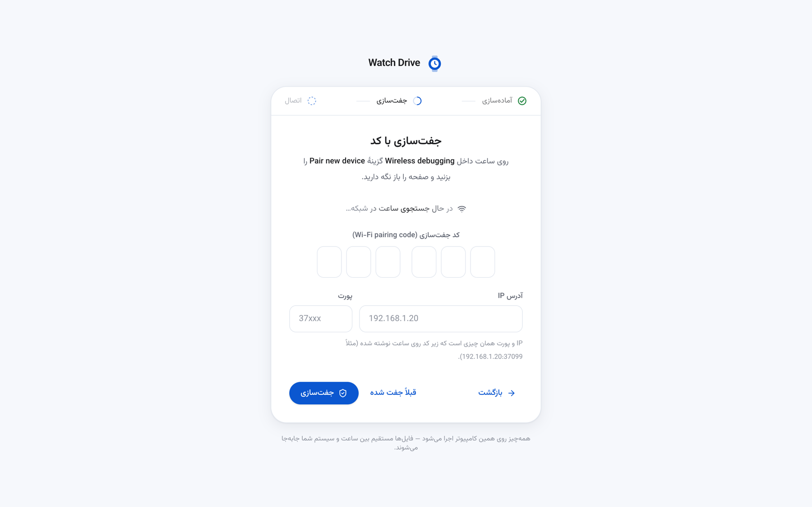

<div align="center">

# ⌚ Watch Drive — GalaxyWatch FileManager (ADB)

**مدیریت فایل ساعت‌های Galaxy Watch و Wear OS از طریق ADB روی Wi‑Fi — با رابطی شبیه Google Drive**

بدون نصب هیچ برنامه‌ای روی ساعت · بدون روت · کاملاً لوکال




</div>

---

## فهرست

- [این پروژه چیست؟](#این-پروژه-چیست)
- [تصاویر](#تصاویر)
- [امکانات](#امکانات)
- [پیش‌نیازها](#پیش‌نیازها)
- [نصب و اجرا](#نصب-و-اجرا)
- [اتصال ساعت (قدم‌به‌قدم)](#اتصال-ساعت-قدمبهقدم)
- [نمایش زنده صفحهٔ ساعت](#نمایش-زنده-صفحهٔ-ساعت)
- [میان‌برهای صفحه‌کلید](#میانبرهای-صفحهکلید)
- [تنظیمات (متغیرهای محیطی)](#تنظیمات-متغیرهای-محیطی)
- [معماری و ساختار پروژه](#معماری-و-ساختار-پروژه)
- [API سرور محلی](#api-سرور-محلی)
- [امنیت](#امنیت)
- [رفع اشکال](#رفع-اشکال)
- [اسکریپت‌ها](#اسکریپتها)

---

## این پروژه چیست؟

ساعت‌های Galaxy Watch 4 به بعد (و هر ساعت Wear OS دیگر) راه ساده‌ای برای جابه‌جایی فایل با کامپیوتر ندارند. **Watch Drive** یک وب‌اپ لوکال است که:

1. یک سرور کوچک Node.js روی `127.0.0.1` اجرا می‌کند که مستقیم ابزار `adb` را صدا می‌زند؛
2. یک رابط React (فارسی و راست‌به‌چپ) در مرورگر نشان می‌دهد که حافظهٔ ساعت را مثل Google Drive مرور می‌کنید؛
3. همهٔ ارتباط از طریق **Wireless debugging** روی همان شبکهٔ Wi‑Fi انجام می‌شود — هیچ دیتایی از کامپیوتر شما بیرون نمی‌رود.

> روی **Samsung Galaxy Watch 4 (SM‑R870)** تست شده است؛ روی بقیهٔ ساعت‌های Wear OS 3+ هم که Wireless debugging دارند باید کار کند.

---

## تصاویر

### مدیر فایل

| نمای فهرست | نمای شبکه‌ای (با پیش‌نمایش تصویر) |
| --- | --- |
|  |  |

| حالت تیره (خودکار بر اساس سیستم) | پیش‌نمایش فایل |
| --- | --- |
|  |  |

### نمایش زنده



### ویزارد اتصال

| شروع | آماده‌سازی ساعت | جفت‌سازی با کد |
| --- | --- | --- |
|  |  |  |

---

## امکانات

**مدیریت فایل**
- مرور همهٔ پوشه‌ها (`/sdcard` و پوشه‌های سیستمیِ قابل‌خواندن، بدون نیاز به روت)
- میان‌برهای کناری: حافظهٔ ساعت، دانلودها، موسیقی، تصاویر، دوربین و اسکرین‌شات، ریشهٔ سیستم
- آپلود فایل و **پوشهٔ کامل** — با انتخاب یا کشیدن و رها کردن (Drag & Drop) — همراه با نوار پیشرفت و امکان لغو
- دانلود فایل؛ دانلود پوشه به‌صورت `.tar`
- حذف با امکان **بازگردانی** تا ۶ ثانیه، تغییر نام، ساختن کپی، پوشهٔ جدید
- جابه‌جایی با کشیدن فایل روی پوشه
- پیش‌نمایش تصویر، صوت، ویدیو، متن و PDF
- نمای فهرست/شبکه‌ای، مرتب‌سازی، جستجو، نمایش فایل‌های مخفی
- نمایش فضای استفاده‌شده و درصد باتری ساعت
- مسیر فعلی در URL ذخیره می‌شود، پس دکمه‌های Back/Forward مرورگر کار می‌کنند

**اتصال**
- ویزارد سه‌مرحله‌ای (آماده‌سازی → جفت‌سازی → اتصال)
- پیدا کردن خودکار IP و پورت ساعت با **mDNS**
- به خاطر سپردن ساعت و «اتصال دوباره» با یک کلیک
- تشخیص خودکار قطع اتصال و برگشت به ویزارد؛ اگر جفت‌سازی از بین رفته باشد مستقیم به مرحلهٔ جفت‌سازی می‌رود

**نمایش زنده**
- پخش زندهٔ صفحهٔ ساعت در یک پنل شناور و قابل جابه‌جایی
- کنترل کامل با ماوس: کلیک = لمس، کشیدن = سوایپ، چرخ ماوس = اسکرول (چرخاندن bezel)
- دکمه‌های بازگشت، خانه، روشن کردن صفحه و گرفتن اسکرین‌شات

---

## پیش‌نیازها

| ابزار | نسخه | نصب روی macOS |
| --- | --- | --- |
| Node.js | 22 یا بالاتر | `brew install node` |
| Android platform-tools (`adb`) | آخرین نسخه | `brew install android-platform-tools` |
| scrcpy (فقط برای نمایش زنده) | 5.0.1 (نسخهٔ سرور باید دقیقاً همین باشد) | `brew install scrcpy` |

- روی **Windows/Linux** هم کار می‌کند؛ `adb` را از [platform-tools](https://developer.android.com/tools/releases/platform-tools) بگیرید و در PATH بگذارید (یا با `ADB_PATH` مسیرش را بدهید).
- ساعت و کامپیوتر باید روی **یک شبکهٔ Wi‑Fi** باشند.
- برای نمایش زنده، مرورگر باید از **WebCodecs** پشتیبانی کند (Chrome، Edge، Safari 17+ و نسخه‌های جدید Firefox).

---

## نصب و اجرا

```bash
git clone https://github.com/hoomanjamshidi/GalexyWatch-FileManager-ADB.git
```

```bash
cd GalexyWatch-FileManager-ADB
```

```bash
npm install
```

```bash
npm run dev
```

سپس آدرس **http://127.0.0.1:5173** را در مرورگر باز کنید.

`npm run dev` دو چیز را هم‌زمان اجرا می‌کند:
- **api** — سرور Express روی پورت `4590` (با `tsx watch`، با هر تغییر ری‌استارت می‌شود)
- **web** — سرور Vite روی پورت `5173` که درخواست‌های `/api` را به سرور api پروکسی می‌کند

### اجرای نسخهٔ نهایی (یک پورت)

```bash
npm start
```

این دستور رابط را build می‌کند و همه‌چیز را روی **http://127.0.0.1:4590** سرو می‌کند.

---

## اتصال ساعت (قدم‌به‌قدم)

ویزارد داخل برنامه همهٔ این مراحل را با راهنما نشان می‌دهد؛ این‌جا هم خلاصه‌اش آمده:

### ۱. آماده‌سازی (فقط یک‌بار)
1. **فعال کردن حالت توسعه‌دهنده:** `Settings → About watch → Software information` و چند بار پشت‌سرهم روی **Software version** بزنید.
2. **روشن کردن ADB:** `Settings → Developer options → ADB debugging`
3. **روشن کردن Wireless debugging:** `Developer options → Wireless debugging`

> 💡 اگر Wi‑Fi ساعت مدام قطع می‌شود، بلوتوث ساعت را موقتاً خاموش کنید تا ساعت روی Wi‑Fi بماند.

### ۲. جفت‌سازی (Pair)
روی ساعت: `Wireless debugging → Pair new device`. برنامه IP و پورت جفت‌سازی را از طریق mDNS خودش پیدا می‌کند؛ فقط **کد ۶ رقمی** نمایش‌داده‌شده روی ساعت را وارد کنید. (اگر پیدا نشد، IP و پورتی که زیر کد نوشته شده را دستی وارد کنید.)

### ۳. اتصال (Connect)
پورت اتصال (که با پورت جفت‌سازی فرق دارد و در صفحهٔ اصلی Wireless debugging نوشته شده) هم خودکار پیدا می‌شود. بعد از اتصال، مستقیم وارد مدیر فایل می‌شوید.

دفعه‌های بعد فقط کافی است Wireless debugging روی ساعت روشن باشد و دکمهٔ **«اتصال دوباره»** را بزنید.

<details>
<summary>معادل دستی همین مراحل با adb</summary>

```bash
adb pair 192.168.1.20:37099 123456
```

```bash
adb connect 192.168.1.20:41234
```

```bash
adb devices -l
```

</details>

---

## نمایش زنده صفحهٔ ساعت

از نوار کناری روی **«نمایش زنده»** بزنید. پشت صحنه:

1. سرور محلی فایل `scrcpy-server` (بخش سمت دستگاهِ scrcpy) را با `adb push` روی ساعت می‌فرستد و اجرا می‌کند — **هیچ اپی روی ساعت نصب نمی‌شود**.
2. ویدیوی H.264 از طریق `adb forward` به سرور و از آن‌جا با **WebSocket** به مرورگر می‌رسد.
3. مرورگر با **WebCodecs** آن را دیکد کرده و روی canvas می‌کشد؛ رویدادهای ماوس به پیام‌های کنترلی scrcpy (لمس، اسکرول، کلید) تبدیل می‌شوند.
4. با بستن پنل، پروسهٔ scrcpy روی ساعت متوقف و فایل‌هایش پاک می‌شود.

مسیر `scrcpy-server` به‌طور خودکار از نصب Homebrew پیدا می‌شود؛ در غیر این صورت با `SCRCPY_SERVER_PATH` مشخصش کنید.

---

## میان‌برهای صفحه‌کلید

| کلید | کار |
| --- | --- |
| `Enter` | باز کردن پوشه / پیش‌نمایش فایل |
| `Backspace` | رفتن به پوشهٔ بالاتر |
| `Delete` | حذف موارد انتخاب‌شده (با امکان بازگردانی) |
| `F2` | تغییر نام |
| `⌘A` / `Ctrl+A` | انتخاب همه |
| `Esc` | بستن پیش‌نمایش / لغو انتخاب |

---

## تنظیمات (متغیرهای محیطی)

| متغیر | پیش‌فرض | توضیح |
| --- | --- | --- |
| `ADB_PATH` | `adb` | مسیر فایل اجرایی adb |
| `WATCH_DRIVE_API_PORT` | `4590` | پورت سرور محلی |
| `SCRCPY_SERVER_PATH` | (از Homebrew) | مسیر فایل `scrcpy-server` |

مثال:

```bash
ADB_PATH=/opt/android/platform-tools/adb npm run dev
```

---

## معماری و ساختار پروژه

```
┌──────────── مرورگر ────────────┐        ┌──── سرور محلی (Node) ────┐        ┌──── ساعت ────┐
│ React 19 + Tailwind 4 + Motion │  HTTP  │  Express 5  (127.0.0.1)  │  adb   │  Wear OS     │
│  • ویزارد اتصال                │ ─────▶ │  • server/adb.ts         │ ─────▶ │  /sdcard     │
│  • مدیر فایل (Drive)           │  /api  │  • server/index.ts       │  Wi‑Fi │              │
│  • نمایش زنده (WebCodecs)      │ ◀───── │  • server/mirror.ts      │ ◀───── │ scrcpy-server│
└────────────────────────────────┘   WS   └──────────────────────────┘        └──────────────┘
```

```
.
├── server/                 # بک‌اند Node (با tsx اجرا می‌شود، بدون build)
│   ├── index.ts            # مسیرهای Express، اعتبارسنجی ورودی، WebSocket نمایش زنده
│   ├── adb.ts              # پوشش adb: devices/pair/connect/mdns، ls، push/pull، tar و ...
│   └── mirror.ts           # راه‌اندازی scrcpy-server و پروتکل ویدیو/کنترل
├── src/                    # فرانت‌اند React
│   ├── App.tsx             # تشخیص اتصال، جابه‌جایی بین ویزارد و Drive
│   ├── wizard/             # ConnectWizard — آماده‌سازی، جفت‌سازی، اتصال
│   ├── drive/              # Drive، Sidebar، FileView، Overlays (پیش‌نمایش/دیالوگ)، Transfers
│   ├── mirror/             # LiveView و useMirror (WebSocket + VideoDecoder)
│   ├── components/         # کامپوننت‌های UI پایه، حالت‌های بارگذاری، آیکون وضعیت
│   └── lib/                # api.ts (کلاینت)، format.ts (تاریخ شمسی/حجم)، saved.ts
├── docs/screenshots/       # تصاویر همین README
├── index.html
├── vite.config.ts          # پروکسی /api → 4590
└── package.json
```

**تکنولوژی‌ها:** React 19 · Vite 8 · TypeScript · Tailwind CSS 4 · Motion · lucide-react · فونت Vazirmatn · Express 5 · Multer · ws

---

## API سرور محلی

همهٔ مسیرها (به‌جز `devices`، `discover`، `pair` و `connect`) پارامتر `serial` دستگاه را می‌گیرند.

| متد | مسیر | کار |
| --- | --- | --- |
| `GET` | `/api/devices` | فهرست دستگاه‌های adb |
| `GET` | `/api/discover` | پیدا کردن سرویس‌های ADB در شبکه (mDNS) |
| `POST` | `/api/pair` | جفت‌سازی با `host`، `port`، `code` |
| `POST` | `/api/connect` | اتصال به `host:port` |
| `POST` | `/api/disconnect` | قطع اتصال |
| `GET` | `/api/info` | مدل، باتری و فضای ذخیره‌سازی |
| `GET` | `/api/ls` | فهرست محتوای یک پوشه |
| `POST` | `/api/mkdir` | ساخت پوشه |
| `POST` | `/api/delete` | حذف |
| `POST` | `/api/move` | جابه‌جایی / تغییر نام |
| `POST` | `/api/copy` | کپی |
| `GET` | `/api/download` | دانلود فایل (پوشه به‌صورت tar) |
| `PUT` | `/api/upload` | آپلود فایل |
| `WS` | `/api/mirror` | جریان نمایش زنده |

---

## امنیت

- سرور فقط روی `127.0.0.1` گوش می‌دهد و از بیرون از کامپیوتر شما در دسترس نیست.
- WebSocket نمایش زنده فقط از origin‌های `localhost`/`127.0.0.1` پذیرفته می‌شود.
- مسیرها، serial، IP و پورت قبل از رسیدن به `adb` اعتبارسنجی و برای شل ساعت به‌درستی quote می‌شوند.
- فایل‌ها مستقیم بین ساعت و کامپیوتر جابه‌جا می‌شوند؛ هیچ سرویس ابری در کار نیست.

---

## رفع اشکال

| مشکل | راه‌حل |
| --- | --- |
| «adb روی این سیستم پیدا نشد» | platform-tools را نصب کنید یا `ADB_PATH` را تنظیم کنید. |
| ساعت در جستجوی شبکه پیدا نمی‌شود | مطمئن شوید هر دو روی یک Wi‑Fi هستند؛ بعضی روترها mDNS را مسدود می‌کنند — IP و پورت را دستی وارد کنید. |
| اتصال مدام قطع می‌شود | ساعت را بیدار نگه دارید و بلوتوث ساعت را موقتاً خاموش کنید. |
| بعد از ریست ساعت وصل نمی‌شود | جفت‌سازی از بین رفته؛ برنامه خودش به مرحلهٔ جفت‌سازی برمی‌گردد. |
| نمایش زنده کار نمی‌کند | `scrcpy` را نصب کنید (یا `SCRCPY_SERVER_PATH` بدهید) و از مرورگری با WebCodecs استفاده کنید. |
| `Port 5173 is already in use` | یک نسخهٔ دیگر برنامه در حال اجراست؛ همان را باز کنید یا ببندیدش. |
| بعضی پوشه‌ها «دسترسی مجاز نیست» می‌دهند | بدون روت، adb به پوشه‌های داخلی برنامه‌ها (`/data`) دسترسی ندارد؛ این طبیعی است. |

---

## اسکریپت‌ها

| دستور | کار |
| --- | --- |
| `npm run dev` | اجرای هم‌زمان سرور api و Vite در حالت توسعه |
| `npm run build` | بررسی تایپ‌ها و build رابط در `dist/` |
| `npm start` | build و اجرای نسخهٔ نهایی روی پورت ۴۵۹۰ |
| `npm run lint` | بررسی کد با oxlint |

---

<div align="center">

ساخته‌شده با ❤️ برای صاحبان Galaxy Watch

</div>
